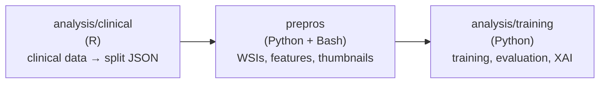

<div align="center">

# Invasive Lobular Carcinoma X-classification

**Whole-slide image classification of TCGA-BRCA histological subtypes (ILC vs. NST)**
using Multiple-Instance Learning on foundation-model patch embeddings (UNI2, UNI2-h, HOPTIMUS0)


</div>

---

## Overview

The project is split into three sub-projects:

| Folder               | Language      | Role                                                                   |
|----------------------|---------------|------------------------------------------------------------------------|
| [`prepros/`](prepros/)                     | Python + Bash | Download WSIs / features, inspect HDF5 files, generate 1/16 PNG thumbnails |
| [`analysis/clinical/`](analysis/clinical/) | R             | Clean clinical data, build the ILC vs. NST split, export split JSON    |
| [`analysis/training/`](analysis/training/) | Python        | Train AttentionMIL, evaluate, run XAI analyses                         |



## Table of contents

- [Requirements](#requirements)
- [Quickstart](#quickstart)
- [Repository layout](#repository-layout)
- [Data](#data)
- [Sub-project READMEs](#sub-project-readmes)
- [Notes](#notes)

---

## Requirements

- **Python 3.13.2** — see [`requirements.txt`](requirements.txt)
- **R ≥ 4.4** — see [`analysis/clinical/README.md`](analysis/clinical/README.md)
- **OpenSlide** (system library) — required by `openslide-python`
- **`gdc-client`** — required to download WSIs from the GDC

---

## Quickstart

### 1. Python environment

```bash
python3.13 -m venv .venv
source .venv/bin/activate
pip install --upgrade pip
pip install -r requirements.txt
```

### 2. R environment

```r
install.packages(c(
  "tidyverse", "gtsummary", "labelled",
  "gt", "jsonlite", "naniar"
))
```

### 3. Pipeline

Run the three sub-projects **in order**:

```bash
# 1. Clinical data → train/test split JSON
cd analysis/clinical
Rscript script_analysis_clinical_data_tcga_20261027.R

# 2. Data download + preprocessing
cd ../../prepros
bash utils/get_wsi_tcga_pred.sh
python download_emb_TCGA_BRCA.py
python utils/wsi_to_png.py data/wsi data/png_wsi

# 3. Training + evaluation + XAI
cd ../analysis/training
python pipeline_training_ilc.py
python infer_models_test_sets.py
```

---

## Repository layout

```text
ilc_Xclass_20261026/
├── analysis/
│   ├── clinical/          # R: clinical data prep, train/test split
│   └── training/          # Python: MIL training, evaluation, XAI
├── prepros/               # Python + Bash: WSI and feature download
├── env_ils_xclass/        # Python virtual environment (not versioned)
├── requirements.txt
└── README.md              # this file
```

---

## Data

| Data                               | Location                                          |
|------------------------------------|---------------------------------------------------|
| Raw WSIs                           | `prepros/data/wsi/`                               |
| 1/16 PNG thumbnails                | `prepros/data/png_wsi/`                           |
| UNI2 / HOPT0 / UNI2-h features     | `prepros/{UNI2,HOPT0,UNI2-h_features}/`           |
| Clinical exports (GDC)             | `analysis/clinical/data/`                         |
| Train/test split JSON              | `analysis/clinical/output/dataset*.json`          |
| Trained checkpoints                | `analysis/training/output/results/weights/*.pth`  |
| Run outputs (JSON, CSV, SVG, XAI)  | `analysis/training/output/results/<run_id>/`      |

---

## Sub-project READMEs

- [`prepros/README.md`](prepros/README.md) — download, inspect HDF5, generate thumbnails
- [`analysis/clinical/README.md`](analysis/clinical/README.md) — clinical cleaning, split, JSON exports
- [`analysis/training/README.md`](analysis/training/README.md) — training, evaluation, XAI

---

## Notes

- **Reproducibility** — all random operations use seed `42` (Python and R) for split and training reproducibility.
- **Target encoding** — `ILC = 1`, `NST = 0`.
- **Large files** — WSIs, `.h5`, `.pth` and results folders are excluded from version control. See the suggested `.gitignore` in each sub-project README.
- **Virtual environment** — `env_ils_xclass/` is a local virtual environment and must **not** be committed.
