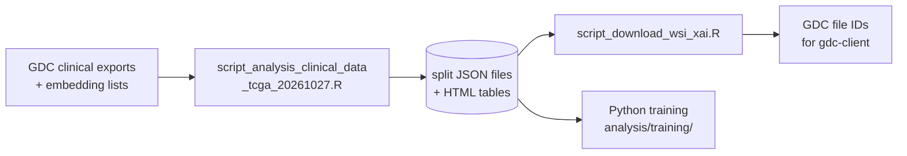

<div align="center">

# ilc_Xclass_20261026 — Clinical data preparation (R)

**R pipeline for the TCGA-BRCA ILC vs. NST classification project**


</div>

---

## Overview

This folder prepares the clinical side of the data, **upstream** of the Python training pipeline (`analysis/training/`).

It is an RStudio project (`analysis_clinical_data.Rproj`). All paths are relative to this folder.

## Table of contents

- [What this pipeline does](#what-this-pipeline-does)
- [Repository structure](#repository-structure)
- [Requirements](#requirements)
- [Installation](#installation)
- [Usage](#usage)
- [Notes](#notes)

---

## What this pipeline does

Two scripts, run **in order**:



### 1️⃣ `script_analysis_clinical_data_tcga_20261027.R`

End-to-end preparation of the clinical data and of the train/test split:

1. **Import** the GDC clinical exports (`data/*.tsv`) and the lists of extracted embeddings (`list_wsi_UNI2_emb.txt`, `asier_dataset_hopt0_*.txt`).
2. **Exploratory analysis**: table dimensions, missingness overview (`naniar::vis_miss`, `miss_var_summary`), fully-missing columns.
3. **Cleaning**:
   - drop empty / unused columns,
   - derive the histological target `ilc.classes` from the ICD-O-3 morphology code (`8500/3` → **NST**, `8520/3` → **ILC**),
   - convert age from days to years,
   - keep only the initial diagnosis (`treatments.initial_disease_status`).
4. **Ambiguity check**: identify and exclude patients assigned to more than one histological subtype (typically 5 cases).
5. **Consistency check** between clinical data and extracted embeddings (UNI2 + HOPT0/“asier”): keep the intersection.
6. **Descriptive tables** (`gtsummary` + `gt`) for ILC vs. NST, and for Train vs. Test — exported as HTML.
7. **80/20 train/test split** at the patient level (seed = 42).
8. **Export** the JSON files consumed by the Python dataloader:
   - `output/split_ids.json`
   - `output/split_targets.json`
   - `output/list_wsi_train.json`
   - `output/dataset.json`
   - `output/dataset_asier.json`
   - `output/dataset_center.json` (centre-simulated split: test set = centres `A8`, `D8`, `AR`; train set = all others)

### 2️⃣ `script_download_wsi_xai.R`

Prepares the **WSI download manifest** for the slides used in the XAI analysis (`analysis/training/xai/`):

1. Load `data/slide_manifest.csv` and `output/dataset_asier.json`.
2. Keep only the slides of interest, split into:
   - `wsi_good_pred` — slides correctly classified by the model,
   - `wsi_wrong_pred` — slides misclassified (to inspect).
3. Build the list of GDC file IDs (`gdc_file_id`) to download with `gdc-client`.
4. Re-export the split JSON files for reproducibility.

> [!NOTE]
> The actual download is done **outside R**, with `gdc-client` (see the `prepros/` README).

---

## Repository structure

```text
analysis/clinical/
├── analysis_clinical_data.Rproj            # RStudio project
├── script_analysis_clinical_data_tcga_20261027.R
├── script_download_wsi_xai.R
│
├── data/                                   # Raw GDC exports (not versioned)
│   ├── clinical.tsv
│   ├── exposure.tsv
│   ├── family_history.tsv
│   ├── follow_up.tsv
│   ├── pathology_detail.tsv
│   ├── ids_emb_uni2.txt
│   ├── list_wsi_UNI2_emb.txt
│   ├── asier_dataset_hopt0_2026*.txt
│   └── slide_manifest.csv
│
├── output/                                 # Generated by the scripts
│   ├── table_clinical_data_20261028.html
│   ├── table_clinical_split_20261028.html
│   ├── split_ids.json
│   ├── split_targets.json
│   ├── list_wsi_train.json
│   ├── dataset.json
│   ├── dataset_asier.json
│   └── dataset_center.json
│
├── .Rhistory                               # (gitignored)
└── README.md
```

---

## Requirements

### R version

- **R ≥ 4.4** (tested with R 4.4.x). Older versions may work but are not officially supported — `gtsummary` and `gt` require recent versions.

### R packages

| Package     | Min. version | Role                                                                                      |
|-------------|--------------|-------------------------------------------------------------------------------------------|
| `tidyverse` | 2.0.0        | Data manipulation (`dplyr`, `tidyr`, `readr`, `purrr`, `stringr`, `tibble`, `ggplot2`, …) |
| `gtsummary` | 2.0.0        | Descriptive summary tables (ILC vs. NST, Train vs. Test)                                  |
| `labelled`  | 2.13.0       | Variable labels for `gtsummary`                                                           |
| `gt`        | 0.11.0       | Rendering / export of summary tables to HTML                                              |
| `jsonlite`  | 1.8.9        | Reading / writing JSON split files                                                        |
| `naniar`    | 1.1.0        | Missingness overview (`vis_miss`, `miss_var_summary`)                                     |

> `tidyverse` pulls in `dplyr`, `tidyr`, `readr`, `purrr`, `stringr`, `tibble`, `ggplot2`, `forcats`, `lubridate` — all used by the scripts.

### System dependencies

- **`pandoc`** (recommended) — used by `gt::gtsave()` to write HTML files. It is bundled with RStudio; otherwise install it from [pandoc.org](https://pandoc.org/installing.html). On most systems `gt` falls back to its own HTML writer, but installing `pandoc` avoids surprises.
- **`gdc-client`** — **not** an R dependency, but required to actually download the WSIs listed by `script_download_wsi_xai.R`. See `prepros/README.md` for installation.

---

## Installation

<details open>
<summary><b>Option A — <code>renv</code> (recommended, reproducible)</b></summary>

If the project already has a `renv.lock` (or after the first `renv::init()`):

```r
install.packages("renv")
renv::restore()
```

</details>

<details>
<summary><b>Option B — manual installation</b></summary>

From an R console, at the root of this folder:

```r
install.packages(c(
  "tidyverse",
  "gtsummary",
  "labelled",
  "gt",
  "jsonlite",
  "naniar"
))
```

</details>

<details>
<summary><b>Option C — <code>pak</code> (fastest)</b></summary>

```r
install.packages("pak")
pak::pkg_install(c(
  "tidyverse",
  "gtsummary",
  "labelled",
  "gt",
  "jsonlite",
  "naniar"
))
```

</details>

### Verify the installation

```r
pkgs <- c("tidyverse", "gtsummary", "labelled", "gt", "jsonlite", "naniar")
sapply(pkgs, requireNamespace, quietly = TRUE)
# Should return TRUE for every package.
```

---

## Usage

Open `analysis_clinical_data.Rproj` in RStudio (the working directory is then automatically this folder), then run the scripts **in order**:

```r
source("script_analysis_clinical_data_tcga_20261027.R")
source("script_download_wsi_xai.R")
```

Or from a terminal:

```bash
Rscript script_analysis_clinical_data_tcga_20261027.R
Rscript script_download_wsi_xai.R
```

### Inputs (must exist before running)

| File                                | Description                                              |
|-------------------------------------|----------------------------------------------------------|
| `data/clinical.tsv`                 | GDC clinical export (main table)                         |
| `data/exposure.tsv`                 | GDC exposure export (mostly empty, not processed)        |
| `data/family_history.tsv`           | GDC family history export (mostly empty)                 |
| `data/follow_up.tsv`                | GDC follow-up export                                     |
| `data/pathology_detail.tsv`         | GDC pathology detail export                              |
| `data/ids_emb_uni2.txt`             | Patient IDs for which UNI2 embeddings exist              |
| `data/list_wsi_UNI2_emb.txt`        | Mapping WSI ↔ UNI2 embedding file                        |
| `data/asier_dataset_hopt0_2026*.txt`| Mapping WSI ↔ HOPT0 embedding file (Prof. Asier)         |
| `data/slide_manifest.csv`           | GDC slide manifest (`patient_id`, `gdc_file_id`, …)      |

### Outputs

- `output/*.html` — descriptive tables (ILC vs. NST, Train vs. Test)
- `output/*.json` — split files consumed by `analysis/training/`:

| File                       | Content                                                                              |
|----------------------------|--------------------------------------------------------------------------------------|
| `dataset.json`             | Standard random 80/20 split (UNI2 features)                                          |
| `dataset_asier.json`       | Same split, HOPT0 (“asier”) features                                                 |
| `dataset_center.json`      | Centre-simulated split: test set = centres `A8`, `D8`, `AR`; train = all other centres |

The JSON schema matches what `TrainingConfig` + `TCGA_BRCA_BagDataset` expect in the Python pipeline:

```json
{
  "train_val": [
    {"id": "TCGA-XX-XXXX", "filename": "...h5", "target": 0},
    ...
  ],
  "test": [
    {"id": "TCGA-YY-YYYY", "filename": "...h5", "target": 1},
    ...
  ]
}
```

---

## Notes

- **Target encoding** — `ILC = 1`, `NST = 0` (constants `ILC_CLASSES` and `ILC_CLASS_CODES` at the top of the script).
- **Ambiguous cases** — patients with more than one histological subtype are excluded (see the ambiguity check above). The count is logged (`nrow(ambiguity_check)`), and the case IDs are kept in `ambiguous_cases` for traceability.
- **Missingness** — `exposure_data` and `family_history_data` are almost entirely missing and are intentionally **not** processed.
- **Seed** — `set.seed(42)` at the top of both scripts, matching the Python training seed for consistency of the split.
- **`.Rhistory`** — automatically written by RStudio; should be excluded from version control.
- **Large data** — `data/*.tsv`, and `output/*.html` / `output/*.json` if they change often, should generally not be committed. Suggested `.gitignore`:

  ```gitignore
  .Rhistory
  .RData
  .Rproj.user/
  data/*.tsv
  output/*.html
  output/*.json
  ```

  Keep at least one reference version of `dataset*.json` under version control if the split is meant to be frozen.

- **`renv`** — for a fully reproducible environment, run `renv::init()` once, commit `renv.lock`, and let collaborators run `renv::restore()`. The versions above are the minimums; the lockfile will pin exact versions.
