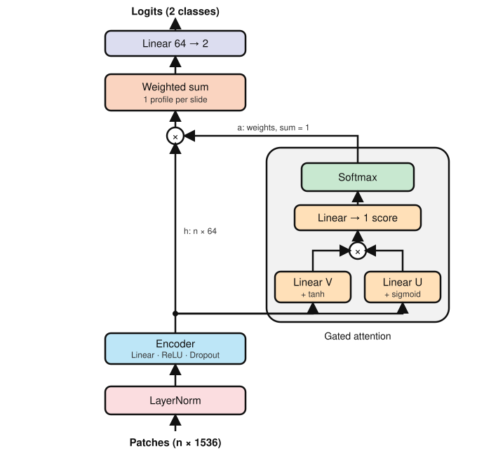
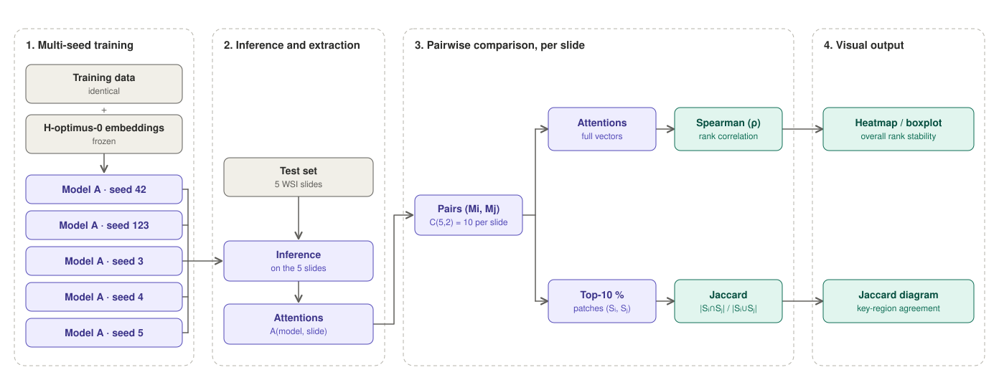
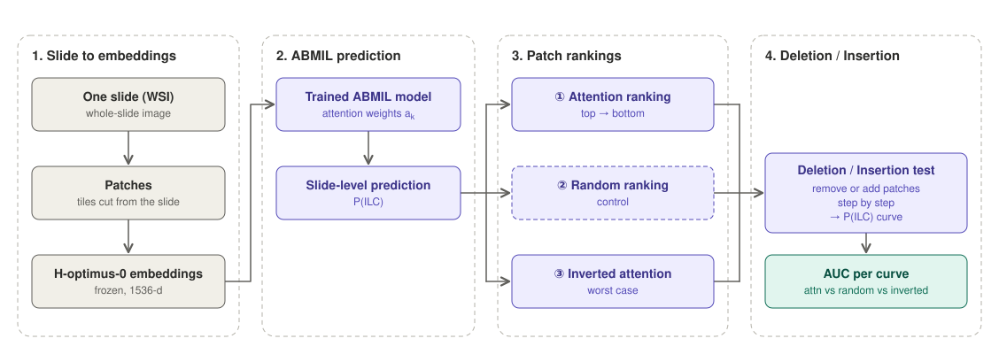

<div align="center">

# Invasive Lobular Carcinoma X-classification : Analysis / Training

**Training, evaluation and explainability (XAI) pipeline for a Multiple-Instance Learning model on TCGA-BRCA whole-slide images**


</div>

---

## Overview

This folder applies a Multiple-Instance Learning (MIL) model to TCGA-BRCA whole-slide images (WSIs), using patch embeddings from foundation models (HOPTIMUS0, UNI2). It contains everything needed to:

1.  **Load** a predefined data split and the corresponding patch embeddings
2.  **Train** an AttentionMIL model with stratified K-fold cross-validation
3.  **Evaluate** it on a held-out test set (bootstrap CIs, confusion matrix, ROC curve, predictions / errors tables)
4.  **Explain** its predictions (attention heatmaps, top/bottom patches, sanity check, leave-one-out, seed stability, deletion/insertion curves)


## Table of contents

- [Repository structure](#repository-structure)
- [Requirements](#requirements)
- [Installation](#installation)
- [Output layout](#output-layout)
- [Usage](#usage)
- [Configuration file](#configuration-file-configabmil_riskyaml)
- [Reproducibility / seed sweep](#reproducibility--seed-sweep)
- [Notes](#notes)

---

## Repository structure

```text
analysis/training/
├── pipeline_training_ilc.py         # Main training entry point (K-fold + final + test)
├── infer_models_test_sets.py        # Global evaluation on a fixed split
├── generate_topbottom_tiles.py      # Attention heatmap + top/bottom patches
│
├── config/
│   ├── __init__.py
│   └── abmil_risk.yaml              # Training / evaluation / XAI configuration
│
├── dataclass/
│   └── config_class.py              # TrainingConfig dataclass (YAML loader + validation)
│
├── dataloader/
│   └── data_loader_bag.py           # TCGA_BRCA_BagDataset + collate_bags
│
├── models/
│   └── MIL_models.py                # AttentionMIL, build_model, EarlyStopping
│
├── train/
│   ├── training_utils.py            # train_one_epoch, evaluate_model, train_fold,
│   │                                # train_final_model, evaluate_model_tta,
│   │                                # run_stratified_kfold_training
│   ├── bootstrap.py                 # Percentile bootstrap confidence intervals
│   └── metrics.py                   # Accuracy, F1, AUC, AUPRC, sensitivity, specificity
│
├── utils/
│   ├── utils.py                     # Logging, JSON export, naming, seeds
│   ├── figures.py                   # Confusion matrix + ROC curve (SVG)
│   └── reports_predictions.py       # Per-slide predictions table
│
├── xai/
│   ├── utils.py                     # Heatmaps, top/bottom patches, LOO, seed stability,
│   │                                # deletion/insertion curves, plotting helpers
│   ├── sanity_check.py              # Compare attention of trained vs randomized model
│   ├── leave_one_out.py             # LOO analysis of the attention maps
│   ├── seed_stability.py            # Attention stability across training seeds
│   └── deletion_insertion.py        # Faithfulness evaluation of the attention maps
│
├── output/
│   └── results/                     # All run outputs (see "Output layout")
│       ├── 20261105_162458_46c9e8/  # One folder per run (run_id)
│       ├── ...
│       ├── logging_ilc_model_<jobid>.out   # SLURM / batch stdout
│       ├── logging_ilc_model_<jobid>.err   # SLURM / batch stderr
│       └── weights/                 # Trained model checkpoints
│           └── model_<arch>_<fm>_seed_<seed>_<run_id>.pth
│
├── requirements.txt
└── README.md
```

---

## Requirements

- **Python 3.13.2** — the exact version used to develop and test this project.
- No C toolchain needed: all Python dependencies ship `cp313` wheels.

<details>
<summary><b>Setting up Python 3.13.2 (pyenv / conda)</b></summary>

**pyenv**

```bash
pyenv install 3.13.2
pyenv local 3.13.2
```

**conda**

```bash
conda create -n ilc_xclass python=3.13.2
conda activate ilc_xclass
```

</details>

---

## Installation

### 1. Python environment

```bash
python3.13 -m venv .venv
source .venv/bin/activate          # Windows: .venv\Scripts\activate
python --version                   # should print: Python 3.13.2
pip install --upgrade pip
pip install -r requirements.txt
```

### 2. System dependencies

[**OpenSlide**](https://openslide.org/) (required by `openslide-python`, used by the XAI scripts to extract patches from the WSI) must be installed at the system level — `pip` only installs the Python bindings.

```bash
# Ubuntu / Debian
sudo apt-get install openslide-tools libopenslide0

# macOS
brew install openslide

# Conda (cross-platform)
conda install -c conda-forge openslide
```

### 3. Data layout (relative to `prepros/`)

The training scripts expect the following paths (configurable in `config/abmil_risk.yaml`):

| Key                                | Expected location                              |
|------------------------------------|------------------------------------------------|
| `paths.h5_dir`                     | Root of the HDF5 features (e.g. `prepros/`)    |
| `paths.path_results`               | `output/results/` (created at runtime)         |
| `paths.save_model_path`            | `output/results/weights/`                      |
| `paths.json_split_wsi_target_path` | Global split JSON (train/val/test slides)      |
| `paths.png_path`                   | `prepros/data/png_wsi/` (1/16 thumbnails)      |
| `paths.wsi_path`                   | `prepros/data/wsi/` (raw WSIs)                 |

> [!NOTE]
> The features of a foundation model `<FM>` are read from `<h5_dir>/<FM_UPPER>/`, one `.h5` file per slide.

---

## Output layout

Every training run creates a **run folder** whose name is the run ID (`YYYYMMDD_HHMMSS_xxxxxx`):

```text
output/results/
├── <run_id>/
│   ├── <run_id>.json                          # Config + folds + test metrics (with CIs)
│   ├── previsions_completes_<run_id>.csv      # All predictions, all splits
│   ├── autopsie_erreurs_global_<run_id>.csv   # Errors sorted by model confidence
│   ├── confusion_matrix_<arch>_<fm>_<run_id>.svg
│   ├── roc_curve_<arch>_<fm>_<run_id>.svg
│   └── xai/                                   # Heatmaps, patches, histograms, curves
├── weights/
│   └── model_<arch>_<fm>_seed_<seed>_<run_id>.pth
└── logging_ilc_model_<jobid>.{out,err}        # Batch / SLURM logs
```

> [!NOTE]
> Figures and CSVs are only produced by `infer_models_test_sets.py` (the training script only writes `<run_id>.json` and the `.pth`). The `xai/` sub-folder is produced by the scripts under `xai/` and by `generate_topbottom_tiles.py`.

---

## Usage

### Train the model (K-fold + final model + test)

#### Architecture

<p align="center">
  
</p>


#### Overview

<p align="center">
  
</p>

#### Run script

```bash

sbatch init_pipeline.slurm

```

This runs:

1. a stratified K-fold cross-validation on the train+validation split,
2. a final training on the whole train+validation set (with a stratified monitoring subset for early stopping / LR scheduling),
3. an evaluation of this final model on the test set with test-time augmentation (TTA),
4. 95 % bootstrap confidence intervals on the test metrics,
5. the export of the results (JSON) and of the final model weights.

**Outputs**

- `output/results/<run_id>/<run_id>.json`
- `output/results/weights/model_<arch>_<fm>_seed_<seed>_<run_id>.pth`

### Evaluate a trained model on a fixed split

```bash
python infer_models_test_sets.py
```

The script loads the checkpoint given by `evaluation.infer_model` in `config/abmil_risk.yaml` and produces, in `output/results/<model_id>/`:

- `confusion_matrix_<arch>_<fm>_<model_id>.<ext>` (SVG by default)
- `roc_curve_<arch>_<fm>_<model_id>.<ext>`
- `previsions_completes_<model_id>.csv` (all predictions, all splits)
- `autopsie_erreurs_global_<model_id>.csv` (errors sorted by decreasing model confidence)

The 15 most confident test errors are also written to the log.

### Generate attention heatmaps and top/bottom patches

```bash
python generate_topbottom_tiles.py --config config/abmil_risk.yaml \
    --ids TCGA-A2-A04Y TCGA-A7-A426 TCGA-AC-A2FO
```

For each slide, the script writes to `output/results/<model_id>/xai/<slide_id>/`:

- `heatmap.<ext>` — attention overlaid on the 1/16 PNG
- `top/` — the `xai.top_k` most attended patches (read from the WSI)
- `bottom/` — the `xai.bottom_k` least attended patches

### XAI analyses

All XAI scripts share the same CLI (`--config`, plus IDs):

#### Overview : normal vs random weigths 

<p align="center">
  
</p>

#### Run script

```bash
# Sanity check: attention of the trained model vs randomized model
python -m xai.sanity_check --config config/abmil_risk.yaml --ids <id> [<id> ...]

```

### Reproducibility / seed sweep

#### Overview

<p align="center">
  
</p>

The repository already contains checkpoints for several seeds of the same architecture and foundation model, e.g.:

```text
output/results/weights/model_abmil_hopt0_seed_42_...pth
output/results/weights/model_abmil_hopt0_seed_123_...pth
output/results/weights/model_abmil_hopt0_seed_456_...pth
output/results/weights/model_abmil_hopt0_seed_789_...pth
output/results/weights/model_abmil_hopt0_seed_1299_...pth
output/results/weights/model_abmil_uni2_seed_42_...pth
```

They are used by `xai/seed_stability.py` to compare the attention maps of different seeds. To run a new seed sweep, edit `paths.seed` in the YAML and re-run `pipeline_training_ilc.py`.

#### Run script

```bash

# Seed stability: compare attention maps of two models trained with different seeds
python -m xai.seed_stability --config config/abmil_risk.yaml \
    --model_ids <id1> <id2> [...] --wsi_ids <slide_id> [<slide_id> ...]

```

### Deletion / insertion

#### Overview

<p align="center">
  
</p>


#### Run script

```bash

# Faithfulness: deletion / insertion curves with random and inverted baselines
python -m xai.deletion_insertion --config config/abmil_risk.yaml --ids <id> [<id> ...]
```

Histograms / curves are saved in `output/results/<model_id>/xai/` (PNG, 300 dpi).

---

## Configuration file (`config/abmil_risk.yaml`)

The YAML file must contain the sections `paths`, `model`, `training`, `evaluation` and `xai`.

> [!IMPORTANT]
> Relative paths are resolved relative to the **parent of the folder containing the YAML file** — except `png_path` and `wsi_path`, which are used as written.

<details>
<summary><b>Example skeleton</b></summary>

```yaml
paths:
  h5_dir: ../../../prepros
  path_results: ../output/results
  save_model_path: ../output/results/weights
  json_split_wsi_target_path: ../../../prepros/data/dataset.json
  png_path: ../../../prepros/data/png_wsi
  wsi_path: ../../../prepros/data/wsi
  seed: 42

model:
  architecture_name: abmil
  foundation_model_name: UNI2
  input_dim: 1536
  num_classes: 2
  classes_name: [IDC, OTHERS]
  class_weights: [1.0, 4.0]

training:
  epochs: 100
  batch_size: 1
  learning_rate: 1.0e-4
  weight_decay_kfold: 1.0e-4
  weight_decay_final: 1.0e-4
  label_smoothing: 0.0
  patience_stop: 20
  factor_sche: 0.5
  patience_sche: 5
  min_lr_sche: 1.0e-6

evaluation:
  n_splits: 5
  test_size: 0.2
  monitor_test_size: 0.2
  bootstrap_niter: 2000
  n_tta: 10
  infer_model: output/results/weights/model_abmil_uni2_seed_42_20261105_222108_877e2e.pth
  subset_name: test
  figures_extension: svg

xai:
  scale_factor: 16
  top_k: 20
  bottom_k: 20
  score_threshold: 0.1
  cmap: jet
  alpha: 0.5
  xai_model: abmil
  top_k_perc: 10
```

</details>

---

## Notes

- **Python version** — this project targets **Python 3.13.2**. Dependency lower bounds in `requirements.txt` are chosen so that `cp313` wheels exist on PyPI (no source builds needed). Older Python interpreters are not supported by these versions.
- **`matplotlib` backend** — figures are generated with the non-interactive `Agg` backend (see `utils/figures.py`), so the scripts run on servers without a display.
- **`__pycache__/`** — the folder contains a mix of `cpython-313` and `cpython-39` bytecode files. The `cpython-39` ones are leftovers from a previous Python installation and can be safely deleted.
- **Large data** — `*.pth` checkpoints, `.h5` features and `output/results/` should be excluded from version control. Suggested `.gitignore`:

  ```gitignore
  output/results/weights/*.pth
  output/results/*/xai/
  output/results/logging_ilc_model_*.{out,err}
  __pycache__/
  *.pyc
  ```

- **Machine-specific config** — `config/abmil_risk.yaml` may contain absolute paths and the path of the checkpoint to evaluate (`evaluation.infer_model`). Keep machine-specific versions out of version control if needed.
